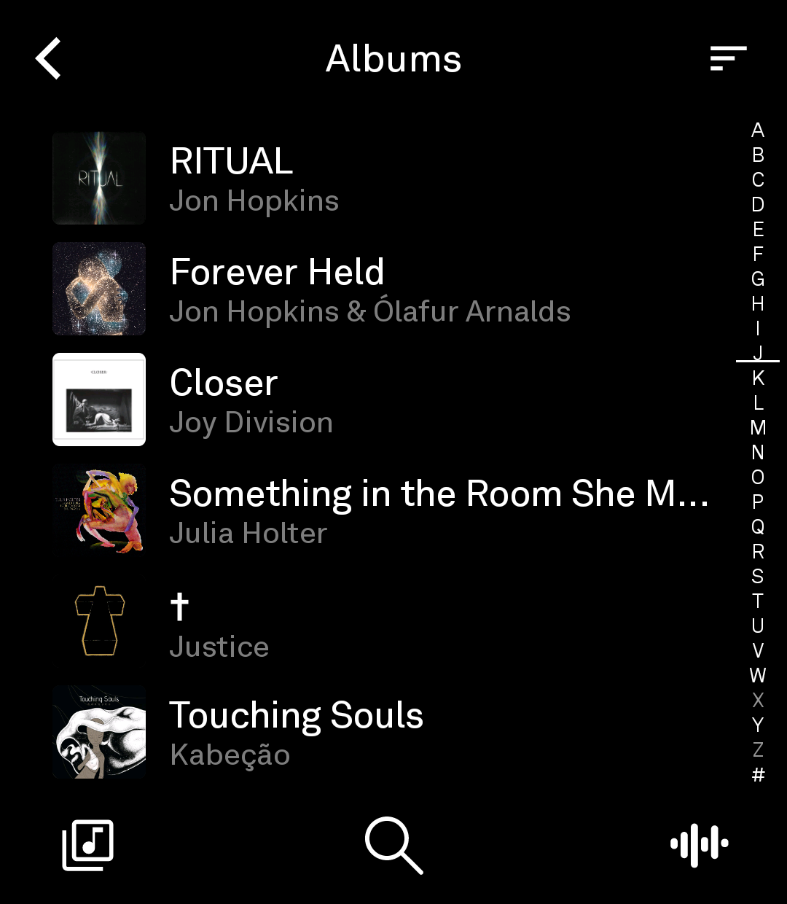
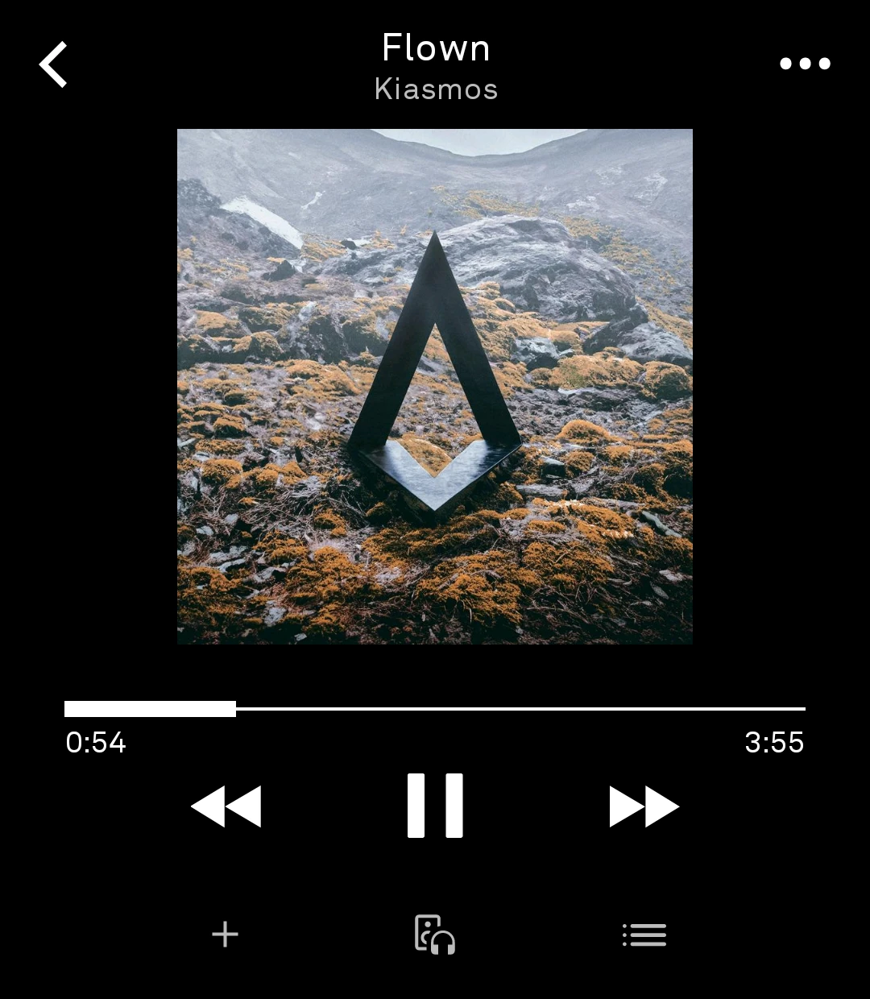
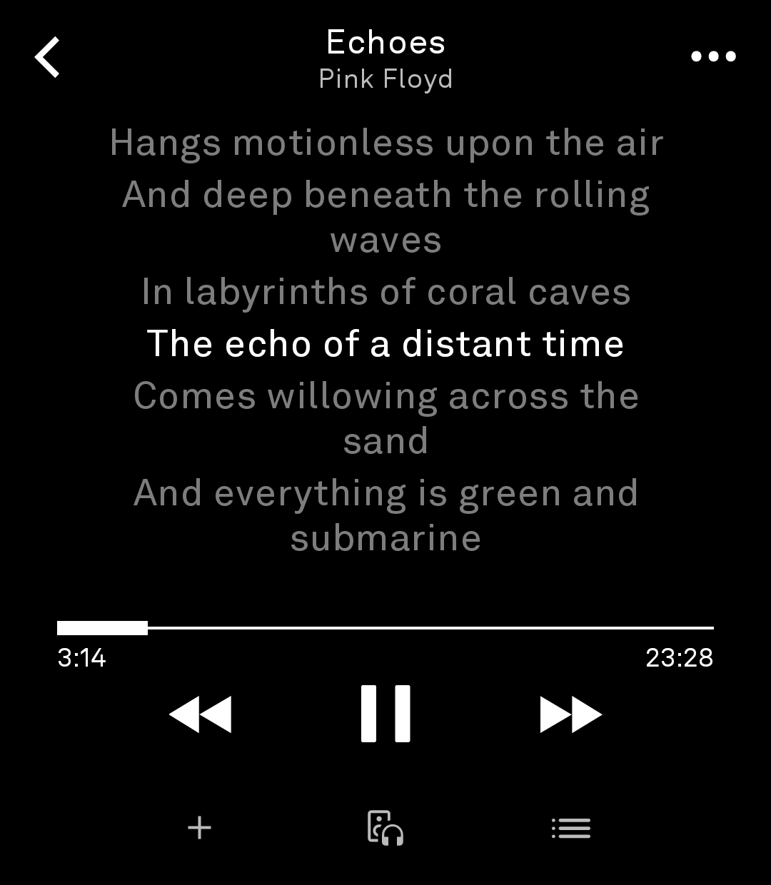
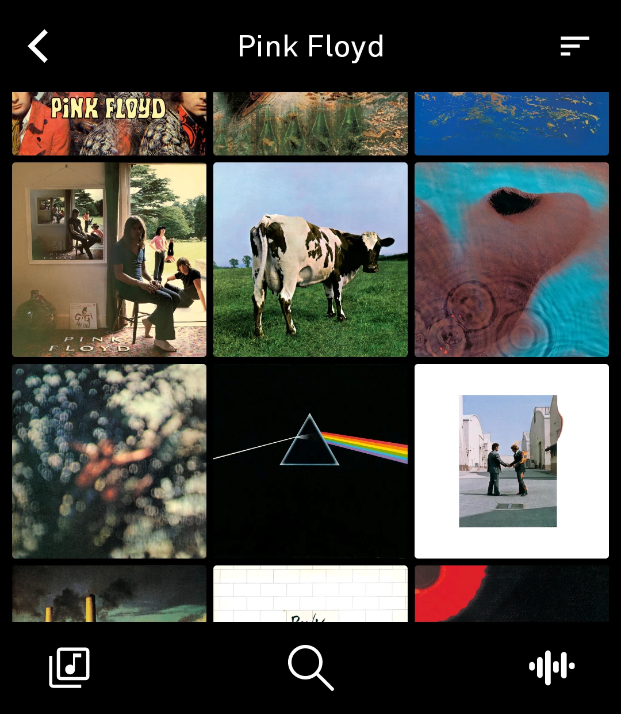

# Amp

A Light Phone III tool that plays music you own: files on the phone, your
Bandcamp collection, or your own Plex, Jellyfin, Navidrome or other Subsonic
server.

<p align="center">
  
  
  
  
</p>
<p align="center"><sub>Shown with Library Tabs and artwork turned on.</sub></p>

> Side-load only for now. Amp isn't in Light's Tool Library yet.

## Features

- Lossless playback.
- Offline downloads, by album, playlist, track, or everything you've liked.
- Data Mode: choose what happens off Wi-Fi. By default Amp streams on cellular
  and leaves downloads for Wi-Fi. Nothing is silently downgraded.
- Synced lyrics. When your server has no timed lyrics for a song, which is
  most songs, Amp looks it up on lrclib.net by title, artist, album and
  length. It does this when you show a song's lyrics and, with Synced Lyrics
  on, for every song it downloads.
- Song radio, on servers that have it.
- Play counts, ratings, likes and playlist edits sync back to the server.
- Cast to a DLNA speaker or receiver. The music passes through the phone, so
  your server login stays on it. Keep the phone on the same Wi-Fi while casting.
- Two looks, in Settings → Appearance. New installs start simple: the phone's
  own three buttons and no artwork. Turn on Library Tabs and Enable Artwork for
  tabs along the bottom and album covers.
- A log of what Amp did, kept on the phone for up to two weeks (1 MB at most)
  so a problem can be looked into later. It shows when you used Amp, your
  servers' kinds and versions and how big your library is. It never holds
  logins, server addresses, or song, album, artist or playlist names, and Amp
  never sends it anywhere.

## Installing

USB debugging needs to be on, in Android's own settings rather than LightOS's:
**Developer options → USB debugging**. Then take the APK from
[Releases](../../releases) and either drop it on
[Light Phone Manager](https://github.com/greghare/light-phone-manager), or:

```bash
adb install -r amp-*.apk
```

To update, install the new APK the same way. Don't uninstall first: that
deletes your downloads, sign-ins and settings.

Hold a song, album or playlist for its options. Hold the top-right button on
any page for Settings. In the simple look, Settings is also the gear at the top
of the Library page.

## Music on the phone

Music gets onto the phone through Light's Tool Manager. On the phone, open
LightOS Settings > Developer > Tool Manager and connect a computer's browser as
it shows. Then open Amp there and upload songs into **Music**. Amp reads them as soon as
the upload finishes. They live in Amp's own storage, so uninstalling Amp
deletes them.

Names come from the tags, not the file names. Embed the artwork in the files:
the Tool Manager can't make folders yet, so every upload lands in one folder
and a `cover.jpg` would cover them all. APE, WavPack and DSD files are skipped.

Playlists are `.m3u8` files in the Tool Manager's **Playlists** folder. Upload
your own there and Amp can edit them like its own. Ones from `Music/Amp/Playlists`
move there the first time Amp starts.

Local likes are saved in `_AmpFavorites.m3u8` in the same folder. Download the
Music and Playlists folders together and the liked songs open as a playlist in
other players. Liked albums and artists are listed in the same file as
`#AMP-ALBUM` and `#AMP-ARTIST` lines.

## Color

Artwork is off on a new install. Turn it on in Settings → Appearance → Enable
Artwork. It's grey until you run this once from a computer:

```bash
adb shell pm grant com.sublunar.amp android.permission.WRITE_SECURE_SETTINGS
```

Color then follows the artwork setting: artwork on means color on. Doing this
without adb is waiting on Light
([light-sdk#190](https://github.com/lightphone/light-sdk/issues/190)).

## Known issues

- ALAC (Apple Lossless) files don't play. The phone's ALAC decoder is broken,
  and Light needs to fix it in a LightOS update
  ([light-sdk#192](https://github.com/lightphone/light-sdk/issues/192)). Until
  then, stream and download in Opus or MP3 (MP3 on Plex), or convert the files
  to FLAC.

Also waiting on Light:

- No controls on the lock screen
  ([light-sdk#136](https://github.com/lightphone/light-sdk/issues/136), being
  fixed in [light-sdk#295](https://github.com/lightphone/light-sdk/pull/295)).
- The back swipe doesn't work in Amp.
- Bluetooth can't be picked in Amp. Connect it in LightOS's settings instead
  ([light-sdk#191](https://github.com/lightphone/light-sdk/issues/191)).
- Paste doesn't work. For a Bandcamp login, use Scan Username & Password
  ([light-sdk#45](https://github.com/lightphone/light-sdk/issues/45)).
- The volume buttons only change Amp's volume while it's on screen, and
  LightOS's volume panel doesn't show
  ([light-sdk#189](https://github.com/lightphone/light-sdk/issues/189)).

[Open an issue](../../issues) for anything else, with the version from
Settings → About. A copy of the log helps: on About, hold the version number
and choose Save a Copy. It goes in Download/Amp, which a computer connected by
USB can read. Read it before you attach it.

## Building

```bash
git submodule update --init
./gradlew :tool:assembleRelease
```

Light's SDK comes in as the `light-sdk` submodule, and the build applies Amp's
patches to it. A build of your own won't install over a release without
uninstalling first.

Where things live: [ARCHITECTURE](tool/docs/ARCHITECTURE.md). What Amp still
needs from Light's SDK: [SDK gaps](tool/docs/SDK-GAPS.md). Bug reports and
ideas: [CONTRIBUTING](CONTRIBUTING.md).

## License

[GNU GPL 3.0](LICENSE): free to use, change and share, as long as what you
share stays open under the same license. Light's SDK stays MIT, © The Light
Phone; see [NOTICE](NOTICE) for the parts under other licenses. Amp 0.8.2 and
earlier were released under MIT, and 0.9.0 to 0.9.2 under PolyForm
Noncommercial 1.0.0.
