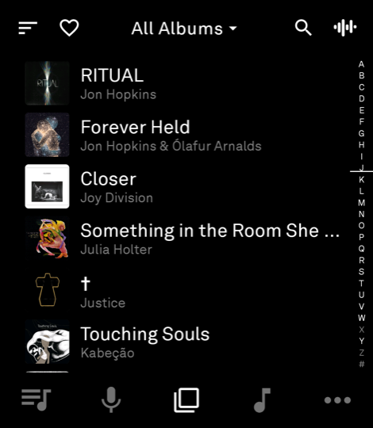
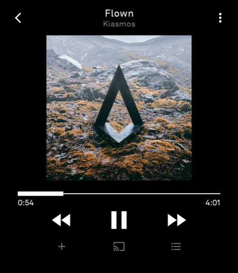
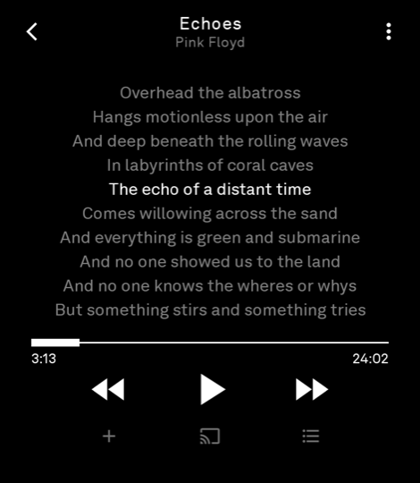
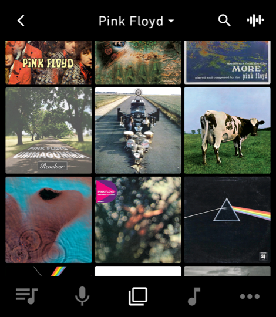

# Amp

A Light Phone III tool that plays music you own: files on the phone, your
Bandcamp collection, or your own Plex, Jellyfin, Navidrome or other Subsonic
server.

<p align="center">
  
  
  
  
</p>

> Side-load only for now. Amp isn't in Light's Tool Library yet.

## Features

- Lossless playback.
- Offline downloads, by album, playlist, track, or everything you've liked.
- Data Mode: choose what happens off Wi-Fi. By default Amp streams on cellular
  and leaves downloads for Wi-Fi. Nothing is silently downgraded.
- Synced lyrics.
- Song radio, on servers that have it.
- Play counts, ratings, likes and playlist edits sync back to the server.
- Cast to a DLNA speaker or receiver, or from Plex to another Plex player (it
  needs "Remote Control: Advertise as Player" turned on).
- Artwork can be turned off completely.

## Installing

USB debugging needs to be on, in Android's own settings rather than LightOS's:
**Developer options → USB debugging**. Then take the APK from
[Releases](../../releases) and either drop it on
[Light Phone Manager](https://github.com/greghare/light-phone-manager), or:

```bash
adb install -r amp-*.apk
```

To update, install the new APK the same way. Don't uninstall first: that
deletes your downloads, sign-ins and settings.

Hold a song, album or playlist for its options. Hold the top-right button on
any page for Settings.

## Music on the phone

Amp reads `Music/Amp`, and nothing else, so music added with Light's Music tool
won't show up.

```bash
adb push ~/Music/some-album "/sdcard/Music/Amp/"
```

Sub-folders are fine. Names come from the tags rather than the folders, and
artwork has to be embedded in the files. A `cover.jpg` next to them won't show.
APE, WavPack and DSD files are skipped.

Playlists live in `Music/Amp/Playlists` as `.m3u8`. One you drop in there shows
up in Amp, but Amp can't change or delete it.

Adding music through Light's Tool Manager, instead of adb, is on the to-do list.

## Color

Artwork is grey until you run this once from a computer:

```bash
adb shell pm grant com.sublunar.amp android.permission.WRITE_SECURE_SETTINGS
```

Color then follows the artwork setting: artwork on means color on. Doing this
without adb is waiting on Light
([light-sdk#190](https://github.com/lightphone/light-sdk/issues/190)).

## Known issues

- ALAC (Apple Lossless) files don't play. The phone's ALAC decoder is broken,
  and Light needs to fix it in a LightOS update
  ([light-sdk#192](https://github.com/lightphone/light-sdk/issues/192)). Until
  then, stream and download in Opus or MP3 (MP3 on Plex), or convert the files
  to FLAC.

Also waiting on Light:

- No controls on the lock screen
  ([light-sdk#136](https://github.com/lightphone/light-sdk/issues/136), being
  fixed in [light-sdk#295](https://github.com/lightphone/light-sdk/pull/295)).
- The back swipe doesn't work in Amp.
- Bluetooth can't be picked in Amp. Connect it in LightOS's settings instead
  ([light-sdk#191](https://github.com/lightphone/light-sdk/issues/191)).
- Paste doesn't work. For a Bandcamp login, use Scan Username & Password
  ([light-sdk#45](https://github.com/lightphone/light-sdk/issues/45)).
- The volume buttons only change Amp's volume while it's on screen, and
  LightOS's volume panel doesn't show
  ([light-sdk#189](https://github.com/lightphone/light-sdk/issues/189)).

[Open an issue](../../issues) for anything else, with the version from
Settings → About.

## Building

```bash
git submodule update --init
./gradlew :tool:assembleRelease
```

Light's SDK comes in as the `light-sdk` submodule, and the build applies Amp's
patches to it. A build of your own won't install over a release without
uninstalling first.

Where things live: [ARCHITECTURE](tool/docs/ARCHITECTURE.md). What Amp still
needs from Light's SDK: [SDK gaps](tool/docs/SDK-GAPS.md). Pull requests:
[CONTRIBUTING](CONTRIBUTING.md).

## License

MIT. The app is © Amp contributors and Light's SDK is © The Light Phone. See
[LICENSE](LICENSE).
